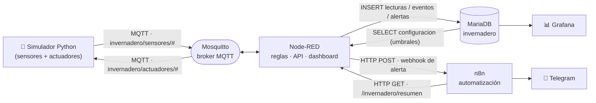

# 🌱 Invernadero IoT — riego y ventilación automáticos

**Proyecto Final Integrador · Taller IoT · INCADE (Posadas, Misiones)**
Integrantes: Anabella Nordfors · Narda Ribeiro

Sistema IoT 100 % software (sensores simulados) que mide el clima de un invernadero, riega y ventila solo. También guarda todo en una base de datos, avisa por Telegram cuando algo anda mal y muestra el historial en Grafana.

---

## 1. El problema

En la zona hay muchos **pequeños productores con invernaderos chicos**: huertas familiares, viveros, plantines. Casi todos riegan y ventilan **a mano y "a ojo"**:

- En los días de calor fuerte, si nadie está presente, la temperatura dentro del invernadero sube muy rápido y **puede arruinar la producción en pocas horas**.
- Regar sin medir **desperdicia agua** o deja el sustrato seco.
- No queda **ningún registro** para saber qué pasó ni para decidir mejor la próxima temporada.

**¿Quién lo tiene?** El productor, que no puede estar todo el día pendiente del invernadero.

**¿Por qué IoT?** Porque el problema necesita **medir de forma continua, actuar sola y avisar a distancia**:

| Necesidad | Cómo la resuelve el sistema |
|---|---|
| Saber qué pasa adentro | Sensores de temperatura, humedad ambiente, humedad del suelo y luz, cada 5 s |
| Actuar sin que haya alguien | Node-RED prende el riego y la ventilación según umbrales |
| Enterarse a tiempo | Alertas por Telegram (vía n8n) si hay temperatura crítica, sustrato seco o se cortan los sensores |
| Decidir con datos | Todo queda en MariaDB y se analiza en Grafana; resumen diario automático |

---

## 2. Arquitectura



**Circuito cerrado:** cuando Node-RED prende el riego, el simulador lo recibe por MQTT y la humedad del suelo empieza a subir. El sistema reacciona de verdad, no solo muestra números.

---

## 3. Cómo cumple la consigna

| Criterio | Obligatorio | Qué usamos |
|---|---|---|
| Problema a resolver | ✅ | Sección 1 |
| Herramienta de automatización (mín. 1) | ✅ | **Node-RED** (reglas automáticas) + **n8n** (alertas y resumen diario) |
| Dispositivos y datos | Opcional | **Script en Python** que simula los sensores y responde a los actuadores |
| Base de datos | ✅ | **MariaDB**: tablas `lecturas`, `eventos`, `alertas`, `configuracion` |
| Protocolo de comunicación (mín. 1) | ✅ | **MQTT** (sensores, actuadores, control, LWT) + **HTTP** (webhook a n8n y API REST de Node-RED) |
| Visualización | Opcional | **Grafana** (historial) + **dashboard de Node-RED** (control en vivo) |

---

## 4. Estructura del repositorio

```
invernadero-iot/
├── README.md
├── simulador/
│   ├── simulador_invernadero.py   # sensores simulados por MQTT
│   └── requirements.txt
├── base-de-datos/
│   └── invernadero.sql            # tablas, umbrales y usuarios
├── node-red/
│   ├── flow-logica.json           # reglas, base de datos, API, webhook
│   └── flow-dashboard.json        # dashboard de control (node-red-dashboard)
├── n8n/
│   └── workflow-invernadero.json  # alertas + resumen diario por Telegram
└── grafana/
    ├── dashboard-invernadero.json # dashboard para importar
    └── datasource-mysql.yaml      # (opcional) provisioning del datasource
```

---

## 5. Comunicación

### Tópicos MQTT

| Tópico | Publica | Payload | Para qué |
|---|---|---|---|
| `invernadero/sensores/temperatura` | Simulador | `31.4` | °C |
| `invernadero/sensores/humedad_ambiente` | Simulador | `66.2` | % |
| `invernadero/sensores/humedad_suelo` | Simulador | `41.8` | % |
| `invernadero/sensores/luz` | Simulador | `28750` | lux |
| `invernadero/simulador/hora` | Simulador | `14:30` | hora del día simulado |
| `invernadero/simulador/conexion` | Simulador / broker | `online` / `offline` | **nacimiento y última voluntad (LWT)** |
| `invernadero/simulador/escenario` | Dashboard | `normal`, `ola_calor`, `sequia`, `falla_riego` | cambiar el escenario en vivo |
| `invernadero/actuadores/riego` | Node-RED | `ON` / `OFF` (retenido) | orden a la bomba |
| `invernadero/actuadores/ventilador` | Node-RED | `ON` / `OFF` (retenido) | orden al ventilador |
| `invernadero/control/modo` | Dashboard | `auto` / `manual` | cambiar de modo |
| `invernadero/control/riego` · `.../ventilador` | Dashboard | `ON` / `OFF` | control manual |
| `invernadero/estado/modo` · `.../actuadores` | Node-RED | texto / JSON (retenido) | estado para el dashboard |

### API HTTP (Node-RED)

| Método | Endpoint | Devuelve |
|---|---|---|
| `GET` | `/invernadero/estado` | Última lectura de cada sensor, estado de actuadores, modo y umbrales |
| `GET` | `/invernadero/resumen` | Mín/máx/promedio de las últimas 24 h, cantidad de riegos, ventilaciones y alertas (consulta MariaDB) |

```bash
curl http://dietpi.local:1880/invernadero/estado
```

### Webhook (Node-RED → n8n)

`POST http://<host-n8n>:5678/webhook/invernadero-alerta`

```json
{
  "tipo": "temperatura_critica",
  "sensor": "temperatura",
  "valor": 38.2,
  "umbral": 38,
  "mensaje": "🔥 Temperatura crítica en el invernadero: 38.2 °C (límite 38 °C)",
  "fecha": "2026-10-27T19:02:23.503Z",
  "modo": "auto",
  "actuadores": { "riego": "OFF", "ventilador": "ON" }
}
```

---

## 6. Lógica de control

Reglas con **histéresis**: el umbral para prender es distinto del umbral para apagar, así el actuador no se prende y apaga a cada rato.

| Actuador | Se prende si… | Se apaga si… |
|---|---|---|
| Riego | humedad del suelo **< 30 %** | humedad del suelo **> 60 %** |
| Ventilador | temperatura **> 32 °C** | temperatura **< 28 °C** |

| Alerta (→ n8n → Telegram) | Condición |
|---|---|
| 🔥 `temperatura_critica` | temperatura ≥ 38 °C |
| 💧 `suelo_seco` | humedad del suelo ≤ 15 % (por ejemplo, si falla la bomba) |
| ⚠️ `sensores_desconectados` | el simulador se cae (mensaje de última voluntad MQTT) |

Hay **anti-spam**: como máximo una alerta del mismo tipo cada 10 minutos.

Todos los umbrales están en la tabla **`configuracion`**. Node-RED la vuelve a leer cada 30 s, así que se pueden cambiar desde phpMyAdmin **sin tocar el flow**.

---

## 7. Instalación paso a paso

> Pensado para la VM **DietPi** del curso (Mosquitto + Node-RED + MariaDB + phpMyAdmin). En los ejemplos, la VM es `dietpi.local`. Si no resuelve, usar la IP.

### 7.1 Base de datos

Desde la consola de la VM:

```bash
sudo mariadb < base-de-datos/invernadero.sql
```

O en **phpMyAdmin** → pestaña **SQL** → pegar el contenido del archivo → Continuar.

Se crea la base `invernadero` con 4 tablas y dos usuarios:

- `nodered` / `nodered123`: lectura y escritura
- `grafana` / `grafana123`: solo lectura

### 7.2 Node-RED

1. **Menú ☰ → Manage palette → Install** e instalar:
   - `node-red-node-mysql`
   - `node-red-dashboard`
2. **Menú ☰ → Import** → pegar `node-red/flow-logica.json` → Import.
3. Repetir con `node-red/flow-dashboard.json`.
4. Abrir el nodo de configuración **MariaDB invernadero**: host `127.0.0.1`, base `invernadero`, usuario `nodered`, contraseña `nodered123`. Debería venir cargado; verificarlo igual.
5. **Deploy**.

Si todo está bien, los nodos mysql muestran **connected** en verde. El dashboard queda en `http://dietpi.local:1880/ui`.

> **URL de n8n:** por defecto Node-RED manda las alertas a `http://localhost:5678/webhook/invernadero-alerta`, o sea, n8n en la misma VM. Si n8n corre en la PC, abrir el nodo **"Preparar alerta"** y cambiar `localhost` por la IP de la PC.

### 7.3 n8n

**Instalarlo** (cualquiera de las tres opciones):

```bash
npx n8n                       # en la PC con Node.js 20 o superior
# o
sudo npm install -g n8n && n8n start      # en la VM
# o con Docker
docker run -it --rm -p 5678:5678 -v n8n_data:/home/node/.n8n docker.n8n.io/n8nio/n8n
```

Abrir `http://localhost:5678` y crear el usuario.

**Bot de Telegram:**

1. En Telegram, hablarle a **@BotFather** → `/newbot` → copiar el **token**.
2. Mandarle cualquier mensaje al bot nuevo.
3. Abrir `https://api.telegram.org/bot<TOKEN>/getUpdates` y copiar el número de `"chat":{"id": ... }`.

**Importar el workflow:**

1. **Workflows → ⋯ → Import from file** → `n8n/workflow-invernadero.json`.
2. En los dos nodos de Telegram: crear la credencial con el token y reemplazar `PONER_TU_CHAT_ID` por el chat id.
3. Si n8n **no** está en la misma máquina que Node-RED, cambiar la URL del nodo **"Pedir resumen a Node-RED"** a `http://dietpi.local:1880/invernadero/resumen`.
4. **Guardar y activar** el workflow (switch *Active*). La URL `/webhook/...` solo funciona con el workflow activo. Mientras se prueba en el editor, n8n usa `/webhook-test/...`.

> ¿Sin Telegram? Se pueden reemplazar los nodos de Telegram por Gmail, Email (SMTP) o Discord. El resto del workflow no cambia.

### 7.4 Grafana

1. Instalar Grafana: en DietPi, desde `dietpi-software`. Suele quedar en el puerto **3001**; en una instalación estándar es el 3000.
2. **Connections → Data sources → Add → MySQL**:
   - Host: `localhost:3306`
   - Database: `invernadero`
   - User: `grafana`
   - Password: `grafana123`
   - **Save & test**

   También se puede usar `grafana/datasource-mysql.yaml` como provisioning.
3. **Dashboards → New → Import** → subir `grafana/dashboard-invernadero.json` → elegir el datasource → Import.

### 7.5 Simulador

En la PC o en la VM, con Python 3:

```bash
cd simulador
pip install -r requirements.txt
python simulador_invernadero.py --broker dietpi.local
```

Opciones útiles:

| Opción | Default | Qué hace |
|---|---|---|
| `--broker` | `localhost` | host o IP de Mosquitto |
| `--escenario` | `normal` | `normal`, `ola_calor`, `sequia`, `falla_riego` |
| `--intervalo` | `5` | segundos reales entre lecturas |
| `--minutos-por-tick` | `10` | minutos simulados por lectura. Con los defaults, **un día dura 12 minutos** |
| `--usuario` / `--clave` | — | si Mosquitto pide usuario |

---

## 8. Guion para la demo

1. **Arranque.** Correr el simulador en escenario `normal` y mostrar en pantalla:
   - el dashboard de Node-RED,
   - Grafana,
   - la tabla `lecturas` en phpMyAdmin llenándose.
2. **Riego automático.** Cuando la humedad del suelo baja de 30 %, Node-RED prende el riego solo. Se ve en:
   - el dashboard,
   - la consola del simulador (`>> Riego ENCENDIDO`),
   - el timeline de Grafana,
   - la tabla `eventos`, con el motivo.
3. **Ola de calor.** En el dashboard, *Escenario → Ola de calor*. Se prende la ventilación y, si pasa los 38 °C, llega la **alerta 🔥 a Telegram**.
4. **Falla de la bomba.** Escenario *Falla de la bomba de riego*: el riego se prende pero no moja. El suelo baja hasta 15 % y llega la **alerta 💧**.
5. **Modo manual.** Activar *Modo manual* y usar los botones Regar / Ventilar.
6. **Corte de sensores.** Cerrar el simulador. El broker publica la **última voluntad** y llega la **alerta ⚠️**.
7. **Resumen y API.**
   - En n8n, ejecutar a mano el nodo *Todos los días 20:00* para mandar el resumen del día.
   - Mostrar `curl .../invernadero/estado`.
8. **Umbrales editables.** En phpMyAdmin, cambiar `temp_max` en `configuracion`. En menos de 30 s el sistema usa el nuevo valor.

> Para la demo conviene bajar `alerta_minutos` a `1` en la tabla `configuracion`, así las alertas se repiten rápido.

---

## 9. Problemas comunes

| Síntoma | Solución |
|---|---|
| El simulador no conecta al broker desde la PC | Mosquitto 2.x solo acepta conexiones locales por defecto. Agregar en `/etc/mosquitto/conf.d/local.conf` las líneas `listener 1883` y `allow_anonymous true`, y reiniciar con `sudo systemctl restart mosquitto`. También se puede correr el simulador dentro de la VM. |
| Nodo mysql en rojo: *Access denied* | Revisar usuario y contraseña en el nodo de configuración **MariaDB invernadero**. |
| `/invernadero/resumen` devuelve error 500 | MariaDB no está conectada (ver la fila anterior). |
| No llegan alertas a n8n | El workflow tiene que estar **activo**. Revisar la URL en el nodo "Preparar alerta". El anti-spam espera 10 min entre alertas del mismo tipo. |
| Los botones del dashboard no hacen nada | Primero hay que pasar a **Modo manual**. En automático, Node-RED ignora los comandos y lo avisa en el panel de debug. |
| Grafana dice *No data* | Revisar el rango de tiempo (arriba a la derecha) y que el datasource apunte a la base `invernadero`. |

---

## 10. Posibles mejoras

- **Hardware real:** un ESP32 con ESPHome o Tasmota que publique en los mismos tópicos `invernadero/sensores/...` reemplaza al simulador sin cambiar nada más del sistema.
- Usuario y contraseña en Mosquitto, y TLS.
- Pronóstico del clima por API en n8n para regar menos si va a llover.
- Varios invernaderos: agregar un nivel al tópico (`invernadero/<id>/sensores/...`) y una columna `invernadero_id` en las tablas.
