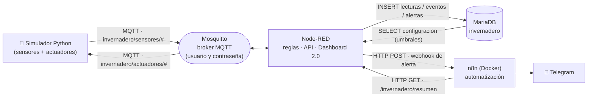

# 🌱 Invernadero IoT — riego y ventilación automáticos

**Proyecto Final Integrador · Taller IoT · INCADE (Posadas, Misiones)**
Integrantes: Anabella Nordfors · Narda Ribeiro

Sistema IoT 100 % software (sensores simulados) que mide el clima de un invernadero y riega y ventila solo. Guarda todo en una base de datos, avisa por Telegram cuando algo anda mal y manda un resumen diario. Además, muestra el estado en vivo en un dashboard con control manual.

---

## 1. El problema

En la zona hay muchos **pequeños productores con invernaderos chicos**: huertas familiares, viveros, plantines. Casi todos riegan y ventilan **a mano y "a ojo"**:

- En los días de calor fuerte, si nadie está presente, la temperatura dentro del invernadero sube muy rápido y **puede arruinar la producción en pocas horas**.
- Regar sin medir **desperdicia agua** o deja el sustrato seco.
- No queda **ningún registro** para saber qué pasó ni para decidir mejor la próxima temporada.

**¿Quién lo tiene?** El productor, que no puede estar todo el día pendiente del invernadero.

**¿Por qué IoT?** Porque el problema necesita **medir de forma continua, actuar sola y avisar a distancia**:

| Necesidad | Cómo la resuelve el sistema |
|---|---|
| Saber qué pasa adentro | Sensores de temperatura, humedad ambiente, humedad del suelo y luz, cada 5 s |
| Actuar sin que haya alguien | Node-RED prende el riego y la ventilación según umbrales |
| Enterarse a tiempo | Alertas por Telegram (vía n8n) si hay temperatura crítica, sustrato seco o se cortan los sensores |
| Decidir con datos | Todo queda en MariaDB; resumen diario automático por Telegram y dashboard en vivo |

---

## 2. Arquitectura



**Circuito cerrado:** cuando Node-RED prende el riego, el simulador lo recibe por MQTT y la humedad del suelo empieza a subir. El sistema reacciona de verdad, no solo muestra números.

Todo corre en una **VM DietPi** (VirtualBox): Mosquitto, Node-RED y MariaDB instalados con `dietpi-software`, y n8n en Docker.

---

## 3. Cómo cumple la consigna

| Criterio | Obligatorio | Qué usamos |
|---|---|---|
| Problema a resolver | ✅ | Sección 1 |
| Herramienta de automatización (mín. 1) | ✅ | **Node-RED** (reglas automáticas) + **n8n** (alertas y resumen diario) |
| Dispositivos y datos | Opcional | **Script en Python** que simula los sensores y responde a los actuadores |
| Base de datos | ✅ | **MariaDB**: tablas `lecturas`, `eventos`, `alertas`, `configuracion` |
| Protocolo de comunicación (mín. 1) | ✅ | **MQTT** con autenticación (sensores, actuadores, control, LWT) + **HTTP** (webhook a n8n y API REST de Node-RED) |
| Visualización | Opcional | **Dashboard 2.0 de Node-RED**: relojes, gráfico en vivo, estado y control manual |

---

## 4. Estructura del repositorio

```
invernadero-iot/
├── README.md
├── simulador/
│   ├── simulador_invernadero.py   # sensores simulados por MQTT
│   └── requirements.txt
├── base-de-datos/
│   └── invernadero.sql            # tablas, umbrales y usuario de Node-RED
├── node-red/
│   ├── flow-logica.json           # reglas, base de datos, API, webhook
│   └── flow-dashboard.json        # dashboard de control (Dashboard 2.0 de FlowFuse)
└── n8n/
    ├── iniciar-n8n.sh             # arranca n8n en Docker
    └── workflow-invernadero.json  # alertas + resumen diario por Telegram
```

> **Contraseñas de laboratorio:** `invernadero123` (MQTT) y `nodered123` (MariaDB) vienen cargadas en los archivos para que el proyecto se pueda importar y probar directo en la VM. Si el sistema se usa fuera del laboratorio, hay que cambiarlas.

---

## 5. Comunicación

### Tópicos MQTT

Mosquitto pide usuario y contraseña. El proyecto usa el usuario **`invernadero`**.

| Tópico | Publica | Payload | Para qué |
|---|---|---|---|
| `invernadero/sensores/temperatura` | Simulador | `31.4` | °C |
| `invernadero/sensores/humedad_ambiente` | Simulador | `66.2` | % |
| `invernadero/sensores/humedad_suelo` | Simulador | `41.8` | % |
| `invernadero/sensores/luz` | Simulador | `28750` | lux |
| `invernadero/simulador/hora` | Simulador | `14:30` | hora del día simulado |
| `invernadero/simulador/conexion` | Simulador / broker | `online` / `offline` | **nacimiento y última voluntad (LWT)** |
| `invernadero/simulador/escenario` | Dashboard | `normal`, `ola_calor`, `sequia`, `falla_riego` | cambiar el escenario en vivo |
| `invernadero/actuadores/riego` | Node-RED | `ON` / `OFF` (retenido) | orden a la bomba |
| `invernadero/actuadores/ventilador` | Node-RED | `ON` / `OFF` (retenido) | orden al ventilador |
| `invernadero/control/modo` | Dashboard | `auto` / `manual` | cambiar de modo |
| `invernadero/control/riego` · `.../ventilador` | Dashboard | `ON` / `OFF` | control manual |
| `invernadero/estado/modo` · `.../actuadores` | Node-RED | texto / JSON (retenido) | estado para el dashboard |

### API HTTP (Node-RED)

| Método | Endpoint | Devuelve |
|---|---|---|
| `GET` | `/invernadero/estado` | Última lectura de cada sensor, estado de actuadores, modo y umbrales |
| `GET` | `/invernadero/resumen` | Mín/máx/promedio de las últimas 24 h, cantidad de riegos, ventilaciones y alertas (consulta MariaDB) |

Se pueden abrir en el navegador: `http://localhost:1880/invernadero/resumen`. La casilla *Pretty-print* lo muestra ordenado.

### Webhook (Node-RED → n8n)

`POST http://127.0.0.1:5678/webhook/invernadero-alerta`

```json
{
  "tipo": "temperatura_critica",
  "sensor": "temperatura",
  "valor": 38.2,
  "umbral": 38,
  "mensaje": "🔥 Temperatura crítica en el invernadero: 38.2 °C (límite 38 °C)",
  "fecha": "2026-11-23T19:02:23.503Z",
  "modo": "auto",
  "actuadores": { "riego": "OFF", "ventilador": "ON" }
}
```

> Se usa `127.0.0.1` y no `localhost` porque en la VM `localhost` puede resolverse a la dirección IPv6 (`::1`) y la conexión falla.

---

## 6. Lógica de control

Reglas con **histéresis**: el umbral para prender es distinto del umbral para apagar, así el actuador no se prende y apaga a cada rato.

| Actuador | Se prende si… | Se apaga si… |
|---|---|---|
| Riego | humedad del suelo **< 30 %** | humedad del suelo **> 60 %** |
| Ventilador | temperatura **> 32 °C** | temperatura **< 28 °C** |

| Alerta (→ n8n → Telegram) | Condición |
|---|---|
| 🔥 `temperatura_critica` | temperatura ≥ 38 °C |
| 💧 `suelo_seco` | humedad del suelo ≤ 15 % (por ejemplo, si falla la bomba) |
| ⚠️ `sensores_desconectados` | el simulador se corta (mensaje de última voluntad MQTT) |

Hay **anti-spam**: como máximo una alerta del mismo tipo cada 10 minutos.

Todos los umbrales están en la tabla **`configuracion`**. Node-RED la vuelve a leer cada 30 s, así que se pueden cambiar desde phpMyAdmin **sin tocar el flow**.

---

## 7. Instalación paso a paso (VM DietPi)

**Requisitos:** VM DietPi en VirtualBox con **Mosquitto, Node-RED, MariaDB y Docker** (instalados con `dietpi-software`), y al menos **2 GB de RAM**. La memoria se cambia con la VM apagada, en *Configuración → Sistema → Placa base → Memoria base*.

Todos los comandos se corren en la terminal de la VM como `root`. Para pegar en LXTerminal se usa **Ctrl + Shift + V**.

### 7.1 Bajar el repo y lo que hace falta

```bash
apt install -y git python3-paho-mqtt fonts-noto-color-emoji
cd ~
git clone https://github.com/almaanabella-harv/invernadero-iot.git
```

`fonts-noto-color-emoji` hace que se vean los íconos de colores en el dashboard.

### 7.2 Base de datos

```bash
mariadb -u root -p < ~/invernadero-iot/base-de-datos/invernadero.sql
mariadb -u root -p -e "SHOW TABLES FROM invernadero;"
```

Pide la contraseña de `root` de MariaDB. Se crean la base `invernadero` con sus 4 tablas y el usuario `nodered` / `nodered123`, que usa Node-RED.

### 7.3 Usuario de Mosquitto

El Mosquitto de DietPi no acepta conexiones sin usuario. Creamos uno para el proyecto:

```bash
mosquitto_passwd -b /etc/mosquitto/passwd invernadero invernadero123
systemctl restart mosquitto
systemctl is-active mosquitto      # tiene que decir: active
```

> El aviso *"File /etc/mosquitto/passwd group is not root"* es normal. **No cambiar los permisos del archivo**: si se cambian, Mosquitto puede dejar de leerlo.

### 7.4 Node-RED

1. Abrir `http://localhost:1880`.
2. **☰ → Manage palette → Install** e instalar, si no están:
   - `node-red-node-mysql`
   - `@flowfuse/node-red-dashboard` (Dashboard 2.0)
3. **☰ → Import → select a file to import**. En la ventana de archivos, **Ctrl + L**, escribir `/root/invernadero-iot/node-red/` e importar **`flow-logica.json`**.
4. Repetir con **`flow-dashboard.json`**.
5. **Deploy**. Si avisa de nodos mal configurados en *otros* flows, **Confirm deploy**.

Los nodos morados (MQTT) y el de MariaDB tienen que decir **connected** en verde. El usuario y la contraseña ya vienen en los flows. Si algún nodo MQTT queda en *connecting*: doble clic en el nodo → lápiz ✏️ al lado de *Server* → pestaña **Security** → usuario `invernadero`, contraseña `invernadero123`.

El dashboard queda en **`http://localhost:1880/dashboard/invernadero`**. Si Node-RED ya tenía un dashboard, la página "Invernadero" se suma a ese, sin duplicarlo.

### 7.5 n8n (en Docker)

n8n corre en Docker porque con Node.js 26, que es el que trae la VM, `npm install -g n8n` falla al compilar un módulo interno.

```bash
sh ~/invernadero-iot/n8n/iniciar-n8n.sh
docker logs -f n8n
```

Cuando aparezca *"Editor is now accessible via…"*, apretar **Ctrl + C** (n8n sigue andando), abrir `http://localhost:5678` y crear el usuario.

### 7.6 Bot de Telegram

1. En Telegram (sirve Telegram Web en la VM: `https://web.telegram.org`), hablarle a **@BotFather** → `/newbot` → copiar el **token**. No compartirlo.
2. Mandarle cualquier mensaje al bot nuevo.
3. Abrir `https://api.telegram.org/bot<TOKEN>/getUpdates` y anotar el número de `"chat":{"id": ... }`. Si sale vacío, mandar otro mensaje y recargar. También se consigue escribiéndole a **@userinfobot**.

### 7.7 Workflow de n8n

1. Crear un workflow nuevo → **⋯ → Import from File…** → `/root/invernadero-iot/n8n/workflow-invernadero.json`.
2. Nodo **Telegram: enviar alerta** → **Set up credential** → pegar el token en *Access Token* → **Save**. En **Chat ID** reemplazar `PONER_TU_CHAT_ID` por el número del paso anterior.
3. Nodo **Telegram: enviar resumen** → elegir la misma credencial y poner el mismo Chat ID.
4. **Ctrl + S** y **Publish**. Sin publicar, el webhook de alertas no funciona.
5. Probar con el botón **Execute workflow from Todos los días 20:00**: llega el resumen a Telegram.

### 7.8 Simulador

```bash
python3 ~/invernadero-iot/simulador/simulador_invernadero.py --usuario invernadero --clave invernadero123
```

Tiene que decir `[MQTT] Conectado al broker` y mostrar una línea cada 5 s. La terminal queda ocupada: para otros comandos, abrir otra pestaña con **File → New Tab**.

| Opción | Default | Qué hace |
|---|---|---|
| `--usuario` / `--clave` | — | usuario de Mosquitto (obligatorio en DietPi) |
| `--broker` | `localhost` | host o IP de Mosquitto |
| `--escenario` | `normal` | `normal`, `ola_calor`, `sequia`, `falla_riego` |
| `--intervalo` | `5` | segundos reales entre lecturas |
| `--minutos-por-tick` | `10` | minutos simulados por lectura. Con los defaults, **un día dura 12 minutos** |

---

## 8. Guion para la demo

1. **Arranque.** Simulador corriendo, dashboard abierto (`/dashboard/invernadero`) y la tabla `lecturas` en phpMyAdmin llenándose.
2. **Riego automático.** Cuando la humedad del suelo baja de 30 %, Node-RED prende el riego solo, y cuando pasa 60 % lo apaga. Se ve en:
   - el gráfico en vivo, con forma de "serrucho",
   - el estado del dashboard,
   - la consola del simulador (`>> Riego ENCENDIDO`),
   - la tabla `eventos`, con el motivo.
3. **Ola de calor.** Dashboard → *Escenario → Ola de calor*. Se prende la ventilación y, si pasa 38 °C, llega la **alerta 🔥 a Telegram**.
4. **Falla de la bomba.** Escenario *Falla de la bomba de riego*: el riego se prende pero no moja, el suelo baja a 15 % y llega la **alerta 💧**.
5. **Modo manual.** Activar *Modo manual* y usar los botones Regar / Ventilar.
6. **Corte de sensores.** Cortar el simulador con Ctrl + C: llega la **alerta ⚠️** por la última voluntad MQTT. Después volver a arrancarlo.
7. **Resumen y API.**
   - En n8n, **Execute workflow from Todos los días 20:00**: llega el resumen del día a Telegram.
   - Mostrar `http://localhost:1880/invernadero/resumen` con *Pretty-print*.
8. **Umbrales editables.** En phpMyAdmin, cambiar `temp_max` en `configuracion`. En menos de 30 s el sistema usa el valor nuevo.

> Para la demo conviene bajar `alerta_minutos` a `1` en la tabla `configuracion`, así las alertas del mismo tipo se pueden repetir rápido.

---

## 9. Problemas que tuvimos y cómo se resuelven

| Síntoma | Solución |
|---|---|
| Simulador: *"El broker rechazó la conexión (Not authorized)"* | Falta usuario o contraseña. Crear el usuario (7.3) y correr con `--usuario invernadero --clave invernadero123`. Las líneas con *SIN CONEXIÓN* no llegaron al broker. |
| Nodos MQTT de Node-RED en *connecting* | Pestaña **Security** del broker con el usuario de Mosquitto (7.4) y **Deploy**. |
| MariaDB: *Access denied for user 'root'* | Usar `mariadb -u root -p` y escribir la contraseña. |
| `npm install -g n8n` falla (`kafka-javascript`, `node-pre-gyp`) | La VM tiene Node.js 26. Usar n8n en Docker (7.5). |
| Docker: *"The container name /n8n is already in use"* | `docker rm -f n8n` y volver a crearlo (el script ya lo hace). |
| n8n: *"port 5678 is already in use"* | Hay otro n8n andando. `docker ps -a` para verlo y apagarlo, por ejemplo: `docker stop docker-n8n-1 docker-postgres-1` y `docker update --restart=no docker-n8n-1 docker-postgres-1`. |
| n8n: *"The service refused the connection"* | Usar `127.0.0.1` en vez de `localhost` en la URL (ya viene así en el workflow). |
| No llegan alertas a Telegram | El workflow tiene que estar **publicado**. Revisar el panel *Debug* de Node-RED (*Respuesta de n8n*) y la pestaña *Executions* de n8n. El anti-spam espera 10 min entre alertas del mismo tipo. |
| `getUpdates` devuelve `"result":[]` | Mandarle otro mensaje al bot y recargar. Con `.../getMe` se confirma que el token es de ese bot. |
| En el dashboard aparecen **▯** en vez de los íconos | `apt install -y fonts-noto-color-emoji` y reabrir Chromium. |
| Los botones del dashboard no hacen nada | Primero hay que pasar a **Modo manual**. En automático, Node-RED ignora los comandos y lo avisa en el panel de debug. |

---

## 10. Posibles mejoras

- **Hardware real:** un ESP32 con ESPHome o Tasmota que publique en los mismos tópicos `invernadero/sensores/...` reemplaza al simulador sin cambiar nada más del sistema.
- TLS en Mosquitto y contraseñas propias por dispositivo.
- Pronóstico del clima por API en n8n para regar menos si va a llover.
- Varios invernaderos: agregar un nivel al tópico (`invernadero/<id>/sensores/...`) y una columna `invernadero_id` en las tablas.
- Grafana para análisis histórico de largo plazo.
